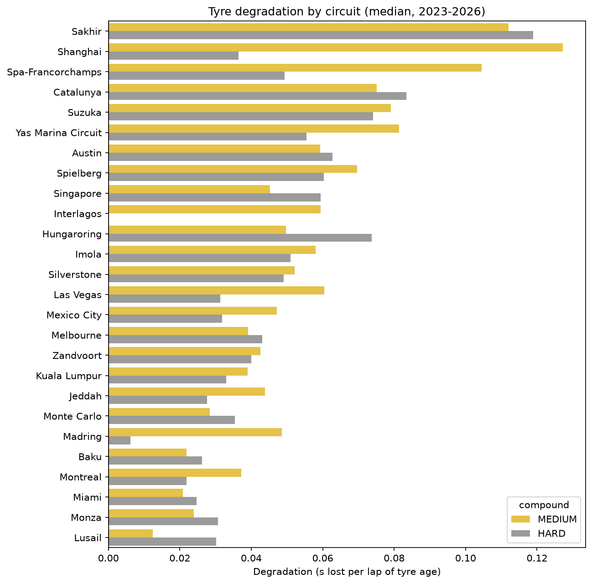
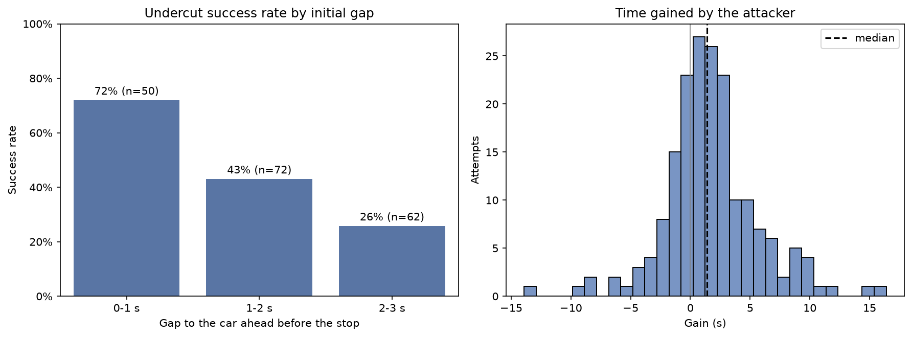
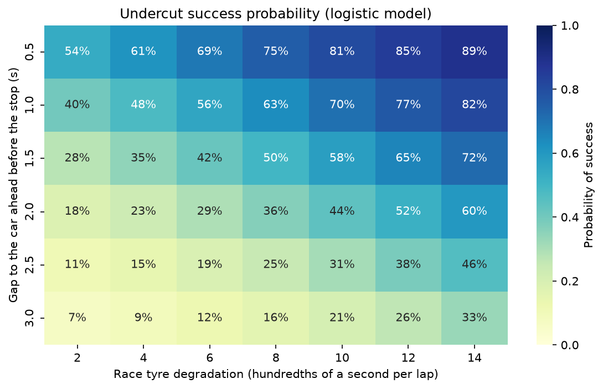
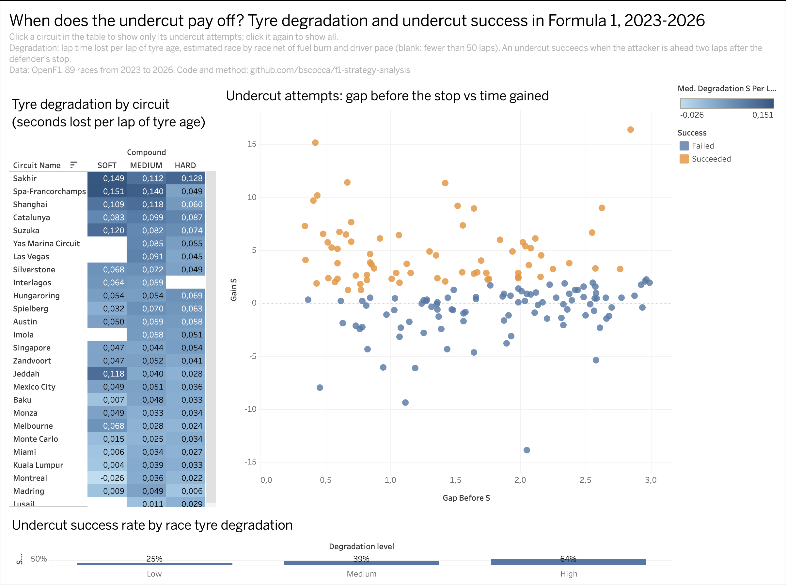
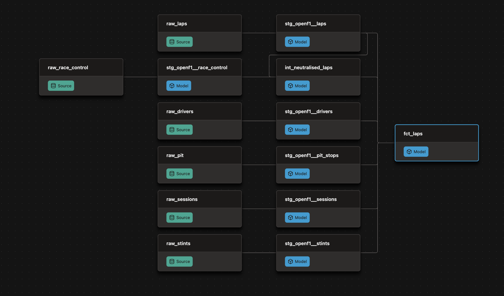

# F1 strategy analysis: tyre degradation and the undercut

How much lap time does each tyre compound lose on each circuit, and when does pitting before the car ahead pay off? An end-to-end analysis of every Formula 1 race from 2023 to 2026, from the raw API data to an interactive app and a BI dashboard.

- **Interactive app:** [f1-strategy-explorer.streamlit.app](https://f1-strategy-explorer.streamlit.app/)
- **Tableau dashboard:** [F1 Strategy: Tyre Degradation and the Undercut](https://public.tableau.com/app/profile/bernadette.scocca/viz/F1StrategyTyreDegradationandtheUndercut/F1strategydashboard)

The app runs on the free tier of Streamlit Community Cloud: if nobody has opened it for a while, it shows a button to wake it up and takes about a minute to start.

## The brief

The project is framed as work for the strategy department of a Formula 1 team, which wants data-driven answers to three questions before each race weekend:

1. **How hard is each circuit on tyres?** How many seconds per lap each compound loses as it ages, once fuel burn and the pace of each car are accounted for.
2. **Did the 2026 regulations change tyre degradation?** New cars and narrower tyres arrived in 2026.
3. **When does the undercut work?** How often pitting before the car ahead gains the position, how much time it gains, and what the odds are given the gap and the circuit.

## Key findings

**Tyre degradation varies by a factor of five between circuits.** Sakhir is the hardest on tyres, at about 0.11-0.12 s lost per lap of tyre age on mediums and hards; at Monza, Miami and Lusail the loss is around 0.02-0.03 s per lap.



**The 2026 regulations did not change degradation systematically.** On the same circuits, the average change against 2023-2025 is +0.001 s/lap for hards and -0.010 s/lap for mediums, well within the race-to-race variation. Individual circuits move in both directions: Barcelona degrades more in 2026, Suzuka less.

**The undercut works in 45% of attempts**, with a median gain of 1.4 s, over 184 attempts measured in green-flag conditions. The gap to the car ahead decides most of it: 72% success within 1 s, 43% between 1 and 2 s, 26% between 2 and 3 s.



**The undercut pays off where tyres degrade.** In low-degradation races it works in 27% of attempts with a median gain of 0.4 s; in high-degradation races in 67% with 2.5 s. The effect holds when controlling for the initial gap: each extra 0.01 s/lap of degradation adds about 0.2 s of gain, and both variables are significant in a logistic model of success (p < 0.001).

**Rule of thumb for the pit wall:** the undercut has at least an even chance when the gap to the car ahead is below about 0.34 + 0.14 × degradation (in hundredths of a second per lap): about 1.2 s on a circuit losing 0.06 s/lap, 1.8 s at 0.10 s/lap, 2.4 s at 0.14 s/lap.



## Deliverables

| Deliverable | Audience | What it does |
|---|---|---|
| [Streamlit app](https://f1-strategy-explorer.streamlit.app/) | Strategists and engineers | Degradation by circuit and season, an undercut calculator (probability of success for a given gap and circuit), and a race explorer with lap times and tyre strategies of any race |
| [Tableau dashboard](https://public.tableau.com/app/profile/bernadette.scocca/viz/F1StrategyTyreDegradationandtheUndercut/F1strategydashboard) | Strategy meeting | One-screen summary: degradation by circuit and compound, every undercut attempt, success rate by degradation level; clicking a circuit filters its attempts |
| [Notebooks](notebooks/) | Analysts | The full analysis, with methods, checks and limits |



## Architecture

An ELT pipeline: the raw data are loaded as they are, and every transformation happens in SQL with dbt, where it is tested and documented.

```
OpenF1 API ──> src/extract.py ──> data/raw/*.json ──> src/load.py ──> DuckDB raw tables
                                                                          │
                                                                          ▼
                                    dbt: staging (8 views) ──> intermediate ──> fct_laps
                                                                          │
                       ┌──────────────────────────────┬───────────────────┘
                       ▼                              ▼
          notebooks 03 and 04            src/export_app_data.py, src/export_bi_data.py
          (degradation, undercut)                     │
                       │                              ▼
                       └──────────────> Streamlit app, Tableau dashboard
```

- **Extract** (`src/openf1_client.py`, `src/extract.py`): downloads seven endpoints per race from the [OpenF1 API](https://openf1.org) (laps, stints, pit stops, race control messages, drivers, weather, results), respecting the rate limit with retries and exponential backoff. Downloads resume after an interruption and files are written atomically.
- **Load** (`src/load.py`): creates one raw table per endpoint in a local DuckDB database.
- **Transform** (`dbt/`): eight staging models clean types, units and names; `int_neutralised_laps` rebuilds safety car, virtual safety car and red flag periods from race control messages; `fct_laps` joins everything into one row per driver per lap, with a flag for laps that reflect race pace.
- **Analyse** (`notebooks/`): regression models in Python with statsmodels.
- **Serve** (`app/`, `bi/`): compact data files exported for the app and the dashboard, so that neither needs the database.

Every column of every dbt model is documented, and 60+ data tests check keys, accepted values and the business rules of the pipeline. The app, the dashboard and the two analysis notebooks are declared as dbt exposures, so the lineage goes from the raw API tables to the products that use them.



## Data quality

Most of the work in a real data project is understanding the data. Issues found and how they are handled:

| Issue in the source | Handling |
|---|---|
| Timestamps arrive without a time zone and were read in local time, two hours off | `to_utc_timestamp` macro in every staging model |
| Some stints have an `UNKNOWN` compound | Treated as null in staging; accepted in the source test |
| Overlapping stints in the wet 2025 Australian GP | `fct_laps` keeps the most recent stint; a warning-level test monitors the issue |
| Some 2026 red flags are only sent as a `SESSION ABORTED` message, without a red flag | Both recognised as red flags in `int_neutralised_laps`, found while investigating unusually long safety car periods |
| No pit stop data for the first six races of 2023, and some stops missing elsewhere | Pit entry laps are also rebuilt from pit exit laps; a test checks that every pit exit lap follows a pit entry lap |
| Under a red flag, cars waiting in the pit lane appear as stops of several minutes | Abnormal stops are excluded from the undercut analysis |

## Methods

**Tyre degradation** (`notebooks/03_tyre_degradation.ipynb`). For each race, a linear regression of lap time on representative laps:

```
lap_time = driver + fuel × lap_number + compound + degradation_compound × tyre_age
```

Driver fixed effects absorb the pace of each car, the lap number captures fuel burn and track evolution, and the interaction gives the seconds lost per lap of tyre age for each compound. Pit stops reset the tyre age while the lap number keeps growing, which lets the model tell fuel and tyres apart. Laps slower than 107% of the driver's median in the race are removed as outliers. Races where fuel and tyre age cannot be separated (rank-deficient design, three wet races in 2025) are skipped.

**The undercut** (`notebooks/04_undercut.ipynb`). The running order and the gaps between cars are rebuilt from lap start times, which are precise to about 0.05 s. An attempt is a green-flag stop by a driver within 3 s of the car ahead, followed by the defender's stop 1 to 3 laps later; the outcome is measured two laps after the defender's stop. Stops for rain, attempts disturbed by a neutralisation, abnormal stops and on-track incidents are excluded. A linear regression (gain) and a logistic regression (success) separate the effect of degradation from that of the initial gap.

## Limits

- 2026 has a single race per circuit, so circuit-level changes against 2023-2025 have an uncertainty comparable to their size.
- Degradation in the undercut analysis is the race average over the dry compounds, not the actual tyres of the two drivers.
- Abnormal stops cannot be excluded in the first six races of 2023, where OpenF1 has no pit stop data.
- Success is measured two laps after the defender's stop: a position gained can still be lost later.
- OpenF1 is a community project, not an official Formula 1 source.

## Repository structure

```
├── src/
│   ├── openf1_client.py       OpenF1 API client with rate limiting and retries
│   ├── extract.py             downloads the raw JSON data
│   ├── load.py                loads the raw data into DuckDB
│   ├── export_app_data.py     builds the data files of the app
│   └── export_bi_data.py      builds the Excel file of the Tableau dashboard
├── dbt/
│   ├── macros/                to_utc_timestamp
│   ├── models/staging/        8 staging views, sources and documentation
│   ├── models/intermediate/   int_neutralised_laps
│   ├── models/marts/          fct_laps and the exposures
│   └── tests/                 custom data tests
├── notebooks/
│   ├── 01_explore_one_race.ipynb
│   ├── 02_data_quality.ipynb
│   ├── 03_tyre_degradation.ipynb
│   └── 04_undercut.ipynb
├── app/                       Streamlit app, its data files and its requirements
├── bi/                        Tableau workbook and its Excel data source
├── images/                    charts used in this README
└── requirements.txt
```

The `data/` folder (raw JSON, DuckDB database, intermediate results) is not in the repository: the steps below regenerate it.

## How to run it

Requirements: Python 3.12 and conda (or any virtual environment).

```bash
conda create -n f1 python=3.12 -y
conda activate f1
pip install -r requirements.txt

# 1. Extract and load (about an hour for all seasons, because of the API rate limit)
python src/extract.py               # or: python src/extract.py --seasons 2025 2026
python src/load.py

# 2. Transform and test
cd dbt
dbt build
dbt docs generate && dbt docs serve # optional: documentation and lineage
cd ..

# 3. Analyse (notebook 04 reads the results of notebook 03)
jupyter nbconvert --to notebook --execute --inplace notebooks/03_tyre_degradation.ipynb
jupyter nbconvert --to notebook --execute --inplace notebooks/04_undercut.ipynb

# 4. Export the data of the app and of the dashboard, and run the app
python src/export_app_data.py
python src/export_bi_data.py
streamlit run app/app.py
```

The OpenF1 API blocks requests from 30 minutes before to 30 minutes after any live session: if the extraction stops with an authentication error during a race weekend, run it again later.

DuckDB is pinned to 1.x because dbt 2 bundles DuckDB 1.x and cannot read files written by DuckDB 2.

## Tech stack

Python (pandas, NumPy, statsmodels, Matplotlib, seaborn, Plotly), DuckDB, dbt, Streamlit, Tableau Public.

## Data and disclaimer

Data from the [OpenF1 API](https://openf1.org), free and open for historical data. This project is unofficial and is not associated with Formula 1 or any Formula 1 company.